# 【README】

本文总结自《图解skill——AI提效实战指南》

---

# 【1】跑通第一个技能

## 【1.2】跑通第一个技能

### 【1.2.1】不用技能

```c++
帮我写一份本周周报，本周做了三件事：
  1. 完成用户调研报告
  2. 修复登录页面的bug
  3. 参加产品评审会
  
  要求：表格格式，三列（任务，进度，备注），语气亲和，保存成markdown文件。
```

### 【1.2.2】创建技能(两种方法)

#### 【1.2.2.1】方法1：使用 /skill-creator 技能创建

1. 需求清晰，直接创建：使用claude code中内置的 /skill-creator 技能创建技能；
   1. <font color=red>skill-creator：是一个创建技能的技能</font>；

【创建周报skill的提示词】

```c++
我想创建一个写周报的技能。每次我告诉它本周做了什么，它就帮我生成一份周报。
  
要求：表格格式，三列：任务，进度，备注。语气亲和，像同事之间汇报工作。最后保存为markdown文件。
```

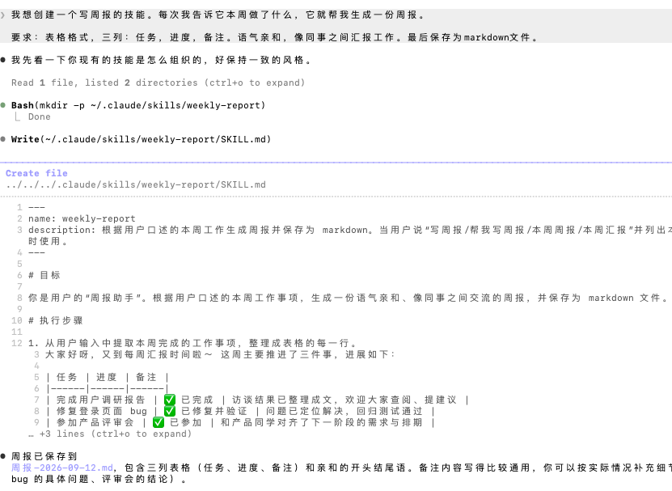

#### 【1.2.2.2】方法2：先对话调试，再固话为技能

步骤1：让智能体帮忙写周报：

```c++
帮我写一份本周周报。本周做了：完成用户调研报告，修复登录页面bug，参加产品评审会。
```

步骤2：调试技能（看到输出后，觉得哪里不对就直接说）：

```c++
1. 把进度修改为百分比的形式；2. 语气太正式了，修改为同事之间汇报工作的语气。3. 周报还是保存为markdown格式文件
```

步骤3（关键的一步）-生成技能：不要退出当前会话，直接对智能体说：

```c++
这份周报的格式和风格我都很满意。帮我基于咱们刚才的对话，把这些要求固话为一个周报技能。以后我只需要告诉你做了什么事，你就按这个标准生成周报。
```

生成周报技能；

#### 【1.2.2.3】让智能体修改技能

提示词：

```c++
周报里加一列“负责人”，帮我更新周报技能。
```

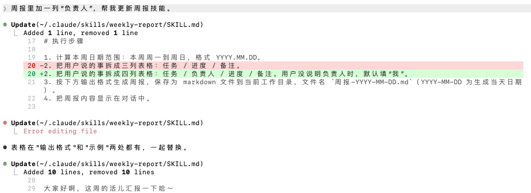

使用刚刚生成的周报技能编写周报：

```
帮我写周报。本周做了：1. 完成用户问题整理； 2. 参加2026年机器人大会； 3. 整理接待A公司领导的行程表，由张三负责；
```

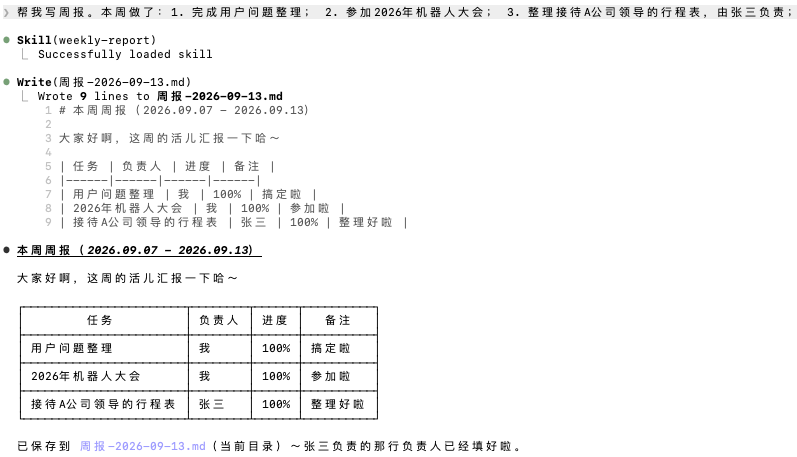

<br>

### 【1.2.3】技能没有生效怎么办？

第1步：确认技能已经安装

```c++
你现在有哪些可用的技能？列出来给我看看。
```

第2步：确认智能体已重启。

第3步：检查description

```c++
帮我看看周报技能的 SKILL.md 的内容，特别是 description 部分写了什么。我刚才说“帮我写本周周报”的时候技能没有触发，帮我分析一下为什么没有触发，并提出优化建议。
```

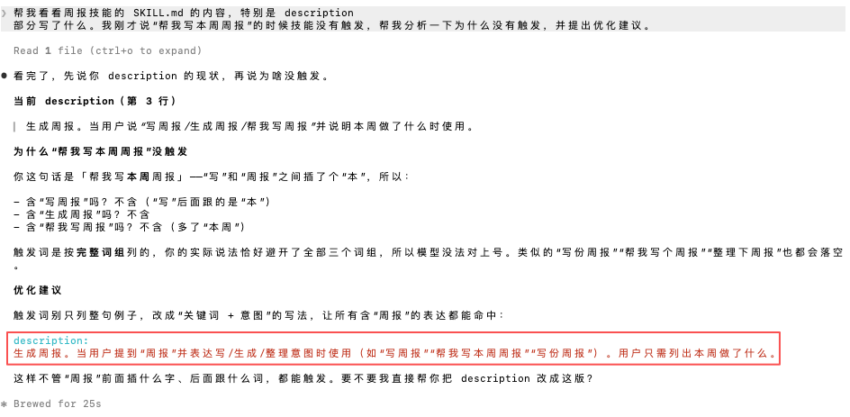

第4步：确认建议合理后，让智能体直接修改：

```c++
按你的建议修改周报技能的 description
```

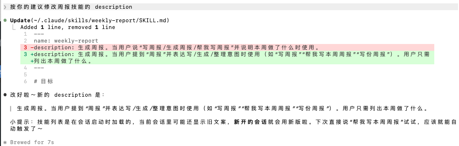

<br>

#### 【1.2.3.1】跑通你的第一个技能总结(提交AI学习笔记)

1. 通过以下步骤创建，使用并优化你的 第一个技能：
   1. 选择其中一个方式创建技能；如 提交ai学习笔记 的技能；
   2. 让智能体确认技能已创建，看看文件路径和内容；
   3. 重启智能体，加载新技能；

【提示词】

```c++
帮我看看 提交AI学习笔记 技能的文件路径和内容
```


<br>

### 【1.2.4】安装别人的技能

提示词：

```c++
请帮我安装 github.com/jimliu/baoyu-skills 里的 baoyu-translate skill
```

<br>

---

## 【1.3】打开技能文件夹看看

看技能文件夹结构：

```c++
帮我看看周报技能的文件夹结构，看看其中包含哪些文件。
```

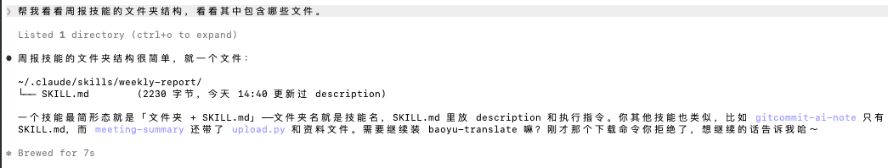

### 【1.3.2】SKILL.md的三个部分

提示词：

```c++
帮我看看周报技能 SKILL.md 的完整内容。
```

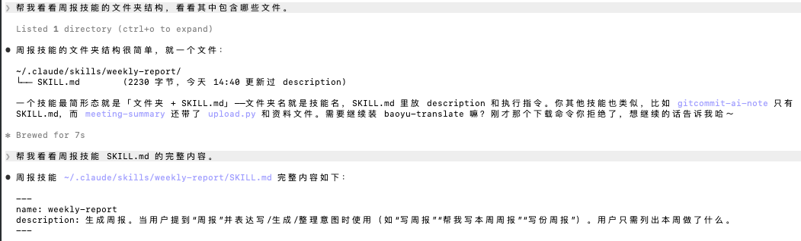

<br>

#### 三个部分

1. name： 技能名称，也是文件夹名称；
2. description： 技能的简介，一两句话说清楚“技能是干什么的，以及什么时候使用”
3. 正文：第二个 --- 之后的内容，具体的操作步骤和规则，其中可能包括执行流程，输出要求和检查清单等； 

<br>

### 【1.3.3】技能存放在哪里

1. 按层级划分：
   1. 全局技能；
   2. 项目技能；

<br>

---

# 【2】理解技能运行的核心逻辑

## 【2.1】智能体的六大要素

### AI聊天机器人与智能体的不同

1. AI聊天机器人：美食顾问，它知道菜谱，但它没有厨房；无论它说的有多好，最后切菜炒菜还是你自己干；
2. 智能体：一个由AI厨师坐镇的厨房系统；
3. <font color=red>AI聊天机器人与智能体区别总结</font>：
   1. AI 聊天机器人=大模型+上下文（有脑子和记忆，但只能纸上谈兵）
   2. 智能体=大模型+上下文+工具+技能（不仅有脑子和记忆，还配齐了工具和操作说明，能够真正动手干活）；

### 智能体六大要素总结（重要）：

1. 智能体有六大核心要素：
   1. 大模型；
   2. 上下文
   3. 工具
   4. 技能；
   5. 指令（提示词）：触发智能体干活的指令；
   6. MCP： 方便智能体接入工具的通用插座；

### 【2.1.1】提示词：你对厨师下的指令

1. 提示词最大特点： 临时性； 因为它只在当前对话中生效； 
2. 提示词： 可以用来下达个性化要求，但不具备跨对话自动生效的能力；

### 【2.1.2】大模型：厨师

1. 大模型：是整个智能体系统的大脑与执行者；

### 【2.1.3】上下文：厨房台面

1. 厨师下厨离不开厨房台面：食材，调料，菜谱，盘子，所有当下要用到的东西都得摆在这块台面上；
2. 上下文：大模型的工作记忆；
   1. 你与智能体对话，当前加载的技能名片，调用工具返回的结果等，都临时放在这块空间里；
   2. 这块记忆空间本身是有限的（它的容量上限就是上下文窗口），往里面放的东西越多，剩余空间就越少；

### 【2.1.4】工具：厨房用具

1. 工具，分为内置工具和扩展工具：
   1. 内置工具：智能体原生具备的基础能力（如读写文件，执行代码，搜索网页）
   2. <font color=red>扩展工具：智能体需要通过特定接口（如插件，API或协议）才能调用的外部能力（如操作浏览器，连接数据库，对接飞书）</font>；

### 【2.1.5】技能：菜谱（大模型使用的操作手册）

1. 技能：就向写给厨师看的菜谱，是写给大模型使用的操作手册；
2. Anthropic公司对技能的定义：技能是一组有组织的文件集合，为智能体打包可组合的流程性知识；
   1. 流程性知识：怎么把一件事做好的知识，如流程，规范和检查清单等；

#### 【2.1.5.1】技能到底是给谁用的？

1. 把智能体拆分为两部分：
   1. 核心的大模型；
   2. 提供支持的智能体运行框架，后称框架；
2. <font color=red>在调用技能时，框架和大模型有明确的分工</font>：
   1. <font color=red>框架负责递本子和跑代码</font>：框架会将 SKILL.md 文件中的内容，以及任务所需的参数文档提取出来，像递本子一样发送给大模型；
      1. 但需要注意：如果技能里包含具体脚本（如python代码），这些代码完全由框架直接在本地运行，不经过大模型；
   2. <font color=red>大模型负责读本子和下指令</font>：大模型负责阅读递过来的SKILL.md 的内容和参考文档，理解任务的步骤和规则。
      1. 弄懂之后， 它会输出一条具体的指令，告诉框架去触发哪个底层脚本；

#### 【2.1.5.2】Anthropic官方对技能的定义

1. 一个完整的技能包：把专供大模型阅读的核心说明书，知识资料等与框架直接运行的脚步打包在一起（只有 SKILL.md 是必需的，其他均为可选）;

### 【2.1.6】MCP：通用插座

1. 背景：智能体需要对接各种外部工具，如数据库，邮件系统，日历，飞书等；这些工具各有各的使用方式，如果每个都要单独适配，无论是用户还是工具厂商，都会乱套；
2. <font color=red>MCP-模型上下文协议：就是为解决这个问题而生的，可以把它理解为AI世界的通用插座</font>；
   1. MCP是一套统一的对接标准，让不同的外部工具，无论是数据库，邮件系统，还是网盘，都能够用同一种方式接入智能体；
   2. 由来MCP这个通用插座， 工具厂商只需要适配一次MCP，所有支持MCP的智能体就都能够用上它的工具；
      1. 智能体也只需要支持一次，就能够对接所有适配了MCP的外部工具； 

#### 【2.1.6.1】工具，技能和MCP的关系

1. 工具，技能和MCP的关系：
   1. 工具让智能体动手干活；
   2. 技能教智能体具体怎么做； 
   3. MCP让各种外部工具无缝接入；

#### 【补充】人类指令 vs 大模型指令

1. 语言格式不同：
   1. 人类指令：人类下达给大模型的指令叫做提示词，用的是人类大白话；【人机沟通】
   2. 大模型指令：大模型下达给框架的指令，是一串结构化的数据格式（比如{"action":"search_weather", "date":"tomorrow"}）；【机器内部协作】
2. <font color=red>身份视角不同</font>：
   1. 大模型：是听从安排的厨师，负责接收你的目标；
   2. 当它转身面对触发设施（框架）时，它就成了发号施令的大脑，负责把目标拆解成具体的工作；

<br>

---

## 【2.2】技能比提示词强在哪里

### 【2.2.2】四大进化（技能比提示词强在哪里的具体表现）

1. 四大进化：
   1. 进化一：打破全量塞入的容量限制，实现按需加载；
   2. 进化二：突破上下文边界，让文件系统成为持久化工作台；
      1. 使用提示词，上下文就是唯一的工作空间；
      2. 智能体配合技能就不一样，中间结果可以随时存储为独立的文件；
         1. 上下文不再是唯一的工作空间，文件系统成了智能体的外部记忆和工作台；
   3. 进化三：摆脱单打独斗，构建协同工作流；
      1. 提示词：单打独斗；
      2. 技能：则可以串成工作流； 
         1. 拿翻译举例：素材分析技能提取核心观点，翻译技能完成翻译，润色技能完成整体校对，文章配图技能为文章添加插图和封面图；（<font color=red>3个技能各司其职，上一个做完下一个接手，这是最符合直接的组合方式</font>）
         2. <font color=red>技能还可以包含脚本，用来处理硬规则性任务</font>；
   4. 进化四：告别碎片化维护，积累经验复利；
      1. 技能以独立文件存在的，而且只有唯一的一份，这意味着它拥有软件工程中常说的单一信源；
      2. 单一信源，原地迭代，改完全局生效，再加上文件天然支持版本管理，你的业务经验可以一直积累下去；

## 【2.3】上下文与按需加载

### 【2.3.1】对话越长，可用空间越少

### 【2.3.2】按需加载：用到什么才拿什么

1. 技能靠的是按需加载策略，官方的专业叫法是渐进式披露：系统不会把所有技能文件一起塞进上下文，而是将其拆分为三层；
   1. 第1层：技能名片（YAML前置信息）
   2. 第2层：技能核心说明书正文（SKILL.md 正文）
   3. 第3层：技能配套资源包（关联文件）；
      1. 参考文档，放入 reference 目录；
      2. 脚本，放入 scripts 目录；
      3. 静态资源，放入 assets 目录；

#### 【2.3.2.1】触发动作与开销

1. 对于参考文档（按需读取）：智能体只有在执行到对应步骤时，才会触发读取动作；不走到那一步，绝不加载；
2. 对于脚本（沙盒运行）：繁重的计算过程完全在上下文之外的独立沙盒中运行，绝不挤占大模型的工作记忆；

<br>

### 【2.3.3】管理上下文的三个技巧

1. 三个技巧：
   1. 技巧1： 按需启用， 严格控制常驻技能的数量； 
   2. 技巧2：主文件（ SKILL.md），必须克制；
      1. 官方明确建议：把 SKILL.md 的正文长度控制在 5000个词元以内（换算成中文，大约不超过3800字），行数不超过500行；
   3. 技巧3：适时开启新对话以清空工作记忆；
      1. SKILL.md 主文件一旦被读取， 就会一直留在那一轮对话的上下文中，挤占工作记忆空间，直到对话结束；
      2. 解决方法： 直接开启一个新对话。 这相当于清空工作记忆，让智能体轻装上阵，重新开始；

## 【2.4】description： 技能被选中的关键机制

### 【2.4.1】智能体式如何相中技能的

1. 你安装的所有技能的 description， 会在智能体启动的瞬间，直接被注入大模型的系统提示词中；
   1. 所以： description的首要读者：是AI，不是人；
   2. 大模型决定要不要调用一个技能的唯一决策：依据的是技能的 description ；

### 【2.4.3】如何写出好的description

1. 极简公式：description =  功能定义  +  触发场景/ 触发词；
   1. 功能定义： 这个技能是用来干什么的；
   2. 触发场景/触发词： 什么时候使用这个技能；
2. 示例：
   1. 生成结构化的工作周报。当用户要求撰写周报，工作总结，工作汇报等内容时使用。

#### 【2.4.3.1】高阶使用：使用反向触发词避免技能抢活

基础写法：

```c++
description: 将文章翻译为目标语言。当用户需要翻译时使用
```

加反向触发词：

```c++
description：将文章翻译为目标语言。当用户需要翻译文章，网页内容哦时使用。不用于润色已有中文内容，不用于改写或摘要。
```

<br>

---

# 【3】从任务到技能五步走

1. 经验总结： 不是所有任务都适合固话为技能，技能也不是越复杂越好；
   1. <font color=red>创建技能前的五件事</font>：
      1. 一个任务该怎么拆；
      2. 哪些环节值得固化成技能；
      3. 哪些活应该交给模型；
      4. 哪些活交给脚本；
      5. 选什么工具干活；

## 【3.1】先把任务拆开看

### 【3.1.1】任何任务拆成三类操作

1. 任务拆分为三类操作：
   1. 执行规则类操作；规矩定过一次，后面每次都一样；如照着菜谱做；
      1. 如标题格式，图表配色，数据精度保留两位小数，结论段必须先写核心发现再写建议等；
   2. 判断类操作；没有固定答案，得看情况来做判断或决策，如决定鱼是清蒸还是红烧；
   3. 调用外援类操作（外部调用）；智能体没有工具，需要连外部；如去外面市场买条鲈鱼；
      1. 原始数据不在本地，在公司数据库里，智能体需要通过某种方式连接上去，还需要知道查询哪张表，哪些字段；

<br>

### 【3.1.2】三种设计模式

1. 三类操作对应三种设计模式，如下：
   1. 执行规则类操作： 对应标准化输出设计模式； 如写周报，发邮件，出标准化报告；
      1. <font color=red>情况1：规则完全固定，要求100%准确，交给脚本做</font>；如数据清洗（剔除空值，统一日期格式）
      2. <font color=red>情况2： 有规则，但没有准确的统一标准；把格式写进SKILL.md</font>；如润色文字，总结结论；
   2. 判断类： 对应流程自动化设计模式；如简历初筛，数据分析；
      1. <font color=red>交给模型来推理</font>；
   3. 调外援： 对应工具增强设计模式；如连接数据库，操作飞书，对接企业微信；
      1. <font color=red>通过MCP接入外部工具</font>，技能里写清楚表名和字段；

2. 任务拆解表：使用下面表格拆分任务
   1. 环节， 执行规则，做判断，请外援； 

<br>

## 【3.2】是否做成技能的判断条件

### 【3.2.1】先问三个问题

1. 三个问题：
   1. 这件事你会反复做吗 
   2. 你对结果的一致性有要求吗
   3. 流程是否已经基本稳定？

2. 是否做成技能的判断条件总结：
   1. 始终生效的规则，放在全局配置里； 
   2. 工具能直接搞定的用工具；
   3. 对于一次性任务，直接使用提示词；

### 【3.2.2】技能的四个限制

1. 4个限制：
   1. 结果不完全确定：同样的输入不一定拿到同样的输出；
      1. 需要确定性环节， 拆出来交给脚本；
   2. 通用与可靠难两全：规则写得越严格，执行越稳定，但适用范围就越窄；
   3. 触发不一定准： description要反复测试；
   4. 不同模型表现不同：复杂技能建议分别测试；

### 【3.2.3】最稳的起步方式（对技能边用边改）

<br>

## 【3.3】如何分配任务给模型与脚本

1. 需要做判断的交给模型，需要执行规则的交给脚本；即 <font color=red>模型做判断，脚本做规则执行 </font>；

### 【3.3.3】提示词，技能，脚本

1. 提示词：语义驱动；适合一次性，简单，高度灵活的任务；
2. 脚本：规则驱动；适合逻辑完全固定，追求100%确定性的操作；
3. 技能：混合驱动，适合反复做，多步串联，既有固定规则也有需要灵活判断的任务；

<br>

### 【3.4.3】工具给能力，技能给经验

1. 智能体有能力但缺乏经验：
   1. 工具就是能力；
      1. 如读取文件，执行代码，搜索网页；
   2. 技能就是经验；（<font color=red>技能的作用就是：该怎么用好这个工具的独家经验写下来 </font>）
      1. 如周报格式规范，翻译术语表，视频压缩标准；

2. 若技能需要调用工具，请在 description和 SKILL.md 里使用完整的工具名称；

---

## 【3.5】安全

### 【3.5.1】三道安全闸

1. 三道安全闸：
   1. 最小权限； 若只需要读取文件，就不要给写入权限；
   2. 二次确认（按暂停键）： 好的技能会在关键节点暂停，等人工确认后再继续；
   3. 可追溯（装摄像头）： 确保智能体的所有操作都有记录，如查了哪些数据，修改了哪些文件，调了哪些工具；

### 【3.5.2】4个习惯

1. 4个习惯：
   1. 安装前，先安检（针对别人的技能，防投毒）； 
   2. 第一次跑，用假数据（针对所有技能，防翻车）； 
   3. 日常干活，建立专属文件夹（针对所有技能，防越权）
   4. 看清弹窗，绝不无脑点“是”（针对所有技能，防误操作）

---

# 【4】动手做：写出你的第一批技能

## 【4.1】写作风格技能：专治AI味儿

### 【4.1.1】痛点：AI味儿去不掉

1. 去AI味儿提示词不起作用，本质上有三个原因：
   1. 同质化污染，所有人都在用同一套去味儿提示词；
   2. 不可复用： 提示词是一次性的；
   3. 缺乏正面锚点：你只告诉AI不要什么，但没有告诉它到底要像谁；

### 【4.1.2】解法： 写一份口味小抄（写一份写作风格特点总结）

【<font color=red>4步写出口味小抄</font>】

第一步：分析写作特点：

提示词：

```c++
分析这几篇文章的写作风格，从以下四个维度总结我的写作特点：用词偏好，句式习惯，结构特点，语气风格。然后帮我创建一个写作风格技能。
```

第二步：用技能写文章。

第三步：审阅并手工修改。

1. 请仔细审阅文章并进行手工修改；

前后对照示例：

```c++
AI原文：作为一名深耕AI 领域多年的老兵，我见证了从传统机器学习到大模型时代的变革。在当今AI飞速发展的时代，掌握智能体技能已经成为不可或缺的能力。
 我改后：作为一名深耕AI领域十多年的从业者，我从机器学习阶段一路走到了大模型阶段。最近一年的变化是： AI不只能够聊天，还能够动手干活了。
```

第四步：分析差异，更新技能。

1. 把修改版和AI版原文一起发起智能体，让它分析你改了什么，为什么改，背后的规则是什么。然后让智能体把这些发现更新到技能文档里。

【注意】<font color=red>走完这四步就完成了一个循环。但你一定要反复使用，持续迭代</font>。

【总结】 四步循环更新技能

1. 分析特点；
2. 用技能写；
3. 人工审阅修改；
4. 更新技能；
5. 分析特点；......

### 【4.1.3】参考模板：我的写作风格技能

一、写作风格技能分为四个部分：

- 角色定位；
- 风格要点；
- 禁止清单；
- 参考资料；

二、写作风格技能模版

```markdown
---
name: writing-style
description: 我的写作风格规范。当需要写文章，润色内容时加载该技能。
---

# 写作风格

## 第一部分： 角色定位
 
 我是[你的身份]，写给[你的读者]看
 口吻像[什么感觉]，不像[什么感觉]。
 
## 第二部分：风格要点
1. [原则一，比如“用词偏好：说人话，不用行业黑话”]
  - 好的例子： [正面示例]
  - 不好的例子： [反面示例]

2. [原则二，比如“句式习惯，短句优先，拒绝冗长，堆砌”]
  - 好的例子
  - 不好的例子

3. [原则三，比如“结构特点：开头无废话，实操具体，可执行”]
  - 好的例子
  - 不好的例子

4. [原则四，比如“语气风格：有观点，有态度”]
  - 好的例子
  - 不好的例子

## 第三部分： 禁止清单

禁止使用以下表达方式

**废话开场白**： 删除
- “在当今...的时代”
- “随着...发展”
- “众所周知”

**强调拐棍**： 删除
- “值得注意的是”
- “不得不说”
- “说实话”

**行业黑话**： 替换为普通说法
- “赋能” -> “帮助”
- “闭环” -> “完整流程”
- “抓手” -> “删除整句重写”

**公式化结尾**： 删除
- “总之”
- “综上所述”
- “让我们拭目以待”

## 第四部分： 参考资料（可选）

俗语对照表：
- AI agent -> 智能体（首次出现时标注英文）
- prompt -> 提示词

代表作用参考：
- [你喜欢的某位作者的专栏链接]
- [你认可的写作风格范围链接]
```

<br>

使用该技能升级你的写作风格技能：把你的初版技能，连同上面的四段式模版一起扔给智能体，提示词如下：

```c++
这是我的写作风格技能，另外一个是标准的四段式模板。请你参考这个模版的结构，把我的写作风格技能能重新整理并输出一份完整的 SKILL.md 文件。
```

<br>

---

## 【4.2】会议纪要技能： 锁死格式

1. 技能目标：给一份会议转录稿或会议笔记，一步到位输出一份格式统一的会议纪要文档；

2. 小结：
   1. 写作风格技能是约束型技能，高度个性化，需要你亲手提取偏好；
   2. <font color=red>会议纪要技能是典型的模板型技能——不需要个性化，只需要标准化</font>；

### 【4.2.2】参考模板：会议纪要技能

```markdown
---
name: meeting-minutes
description: 把会议转录稿或会议笔记整理成格式统一的会议纪要。当用户要求“整理会议纪要”，“写会议记录”时使用
---

# 会议纪要

## 输入

用户提供以下任一形式：
- 会议转录稿
- 会议笔记 
- 与会议相关的聊天截图或文本

## 输出格式

按以下模版生成纪要。

# 会议纪要： [会议主题]

** 日期 **： YYYY-MM-DD
** 参会人 **： [从内容中提取]
** 记录人 **： AI辅助生成， [ 确认人 ]审核

---

## 议题一： [标题]

[讨论要点, 2~3 句话概括]

** 结论 **： [明确的决定， 粗体显示]

---

 ## 议题二： [标题]
 ...

 ---

 ## 待办事项
 | 序号 | 事项 | 负责人 | 截止日期 | 
 | 1 | [具体事项] | [人名] | [日期] | 

 ## 遗留问题

 - [讨论了但没结论的事项]

 ## 写作原则
- 每个议题的讨论概括不超过3句话
- 结论用粗体， 一眼能看到 
- 待办事项必须有负责人和截止日期， 缺失则标注 [待确认]
- 人名保留原文，不翻译，不简写
- 保持客观，不加评价
- 不确定的信息标注 [信息不完整], 不编造 

 ## 输出
 保存为 meeting-minutes-{YYYY-MM-DD}-{会议主题}.md
 示例： meeting-minutes-2025-06-12-Q3产品路线图评审.md
 
```

【会议转录稿】

```c++
张经理： 今天主要讨论两件事，Q2推广计划和新品上线时间
李明： 推广预算我建议增加到50万元，上季度的30万不够用。
王芳： 我同意，但渠道要从抖音换到小红书，转化率更高。
张经理： 好，就定50万， 渠道以小红书为主。李明负责出方案，下周三前给我。
李明： 没问题。
张经理： 第二件事，新品上线时间。 原定3月15号，来得及吗？
王芳： 包装设计还没有定稿， 可能要推迟到月底。
张经理： 那暂定3月25号， 王芳跟设计确认一下，明天给我回复。
李明： 对了，上次说的KOL合作名单我还没有收到。
王芳： 我让小刘发给你，今天之内。
张经理： 好，没别的事情就散会。
```

【提示词：使用 meeting-minutes 技能整理会议纪要】

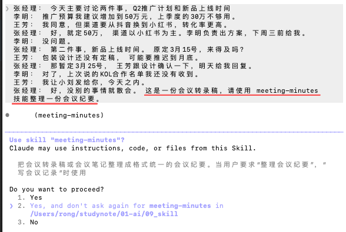

<br>

---

# 【5】组合用：搭建多技能工作流

## 【5.1】先拿会议纪要开刀

### 【5.1.1】可复用的能力别锁死

1. <font color=red>拆分的核心理由：把可复用的能力独立出来，让它到处都能用</font>；

### 【5.1.2】把独立技能拆出来

下面是讨论分析技能的完整模板。它的职责只有一个： 从会议转录稿，会议笔记中提取有价值的信息。

【讨论分析技能模板】

```c++
---
name: discussion-analyzer
description: 接收会议转录稿，会议笔记，项目复盘记录，访谈笔记等，从中提取有价值的信息。当用户要求“分析讨论内容”时使用
---

# 讨论内容分析

## 输入 
会议转录稿， 会议笔记，项目复盘记录， 访谈笔记等

## 分析维度

逐段阅读，提取以下五类信息。

### 1. 关键决定
- 明确达成共识的事项
- 标注： 谁提议，谁支持，谁反对，谁保留意见

### 2. 待办事项
- 会议中明确分配的任务
- 每条必须包含： 事项， 负责人，截止日期
- 没提到截止日期的标注 [待确认]

### 3. 争议点
- 有分歧但没结论的话题
- 记录各方立场： 支持，反对，保留意见

### 4. 背景信息 
- 提到但不需要行动的信息
- 帮助理解上下文

### 5. 过滤
- 闲聊，重复发言，跑题内容不记录

## 输出

按五个维度分五部分，保存到输入文件所在的目录，文件名为  discussion-analysis.md 。

如果该目录下已存在同名文件，先备份旧文件再重命名（如 discussion-analysis-backup-20260315.md ） ,再保存新文件。  

```

<br>

【使用 discussion-analyzer 技能的提示词】

```c++
张经理： 今天主要讨论两件事，Q2推广计划和新品上线时间
李明： 推广预算我建议增加到50万元，上季度的30万不够用。
王芳： 我同意，但渠道要从抖音换到小红书，转化率更高。
张经理： 好，就定50万， 渠道以小红书为主。李明负责出方案，下周三前给我。
李明： 没问题。
张经理： 第二件事，新品上线时间。 原定3月15号，来得及吗？
王芳： 包装设计还没有定稿， 可能要推迟到月底。
张经理： 那暂定3月25号， 王芳跟设计确认一下，明天给我回复。
李明： 对了，上次说的KOL合作名单我还没有收到。
王芳： 我让小刘发给你，今天之内。
张经理： 好，没别的事情就散会。
  
请使用 discussion-analyzer 技能从上述会议转录稿提取有价值的信息
```

<br>

---

### 【5.1.3】两个技能打配合（整合讨论分析技能与会议纪要技能）

1. 对会议纪要技能进行修改，就可以优先读取讨论分析摘要（讨论分析技能的处理结果），然后再生成会议纪要； 

```markdown
---
name: meeting-minutes
description: 将 discussion-analyzer 的讨论分析摘要(discussion-analysis.md) 或者原始的会议转录稿，会议笔记等整理成格式统一的会议纪要。当用户要求 “整理会议纪要” “写会议记录”等时使用
---

# 会议纪要

## 输入

用户提供以下任一形式：
- discussion-analyzer 的讨论分析摘要
- 会议的转录稿 
- 会议笔记
- 与会议相关的聊天截图或文本
```

这样，会议纪要技能技能配置讨论分析技能使用（优先读取讨论分析摘要），也能单独使用；

<br>

#### 【5.1.3.1】升级会议纪要技能

【升级技能的提示词】

```c++
修改 meeting-minutes 技能，让它优先读取 discussion-analysis.md 作为输入。如果没有讨论分析摘要，也可以直接读取原始会议转录稿或会议笔记做处理。
```

#### 【5.1.3.2】结合2个技能生成会议纪要

【提示词】

```c++
张经理： 今天主要讨论两件事，Q2推广计划和新品上线时间
李明： 推广预算我建议增加到50万元，上季度的30万不够用。
王芳： 我同意，但渠道要从抖音换到小红书，转化率更高。
张经理： 好，就定50万， 渠道以小红书为主。李明负责出方案，下周三前给我。
李明： 没问题。
张经理： 第二件事，新品上线时间。 原定3月15号，来得及吗？
王芳： 包装设计还没有定稿， 可能要推迟到月底。
张经理： 那暂定3月25号， 王芳跟设计确认一下，明天给我回复。
李明： 对了，上次说的KOL合作名单我还没有收到。
王芳： 我让小刘发给你，今天之内。
张经理： 好，没别的事情就散会。
  
先使用 discussion-analyzer 分析上述转录稿，输出到 discussion-analysis.md。 分析完成后暂停，把待办事项列给我确认。 我确认完成后，你再用  meeting-minutes 技能生成会议纪要。
```

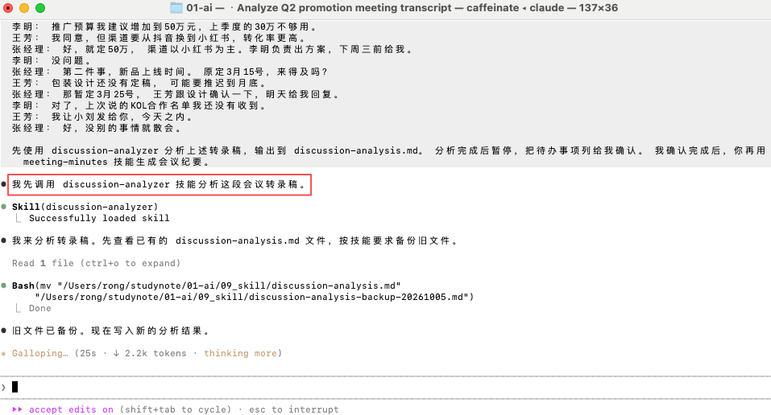

【分析完成后，找我确认】

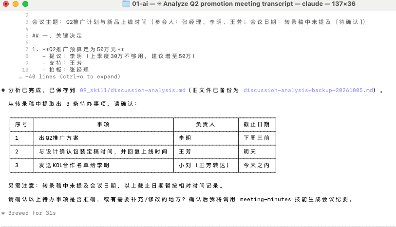

<br>

---

## 【5.2】三种组合方式

### 【5.2.1】串联（先后做）

1. 串联：把两个及以上技能串联起来完成任务的技能组合方式；
   1. 如上面操作中，先执行 discussion-analyzer 技能，再执行  meeting-minutes 技能； 

### 【5.2.2】并联（同时做）

1. 并联：基于同一份素材，让多个技能（或同一个技能的不同方向）同时开工，最后从多个结果中挑选的技能组合方式；
   1. 大纲技能可以根据原始素材和素材分析结果，生成3个不同角度的大纲：A偏故事叙述，B偏逻辑分析，C偏场景对话；然后我觉得3个方向都不错，想让智能体同时按照3个大纲各写一篇，写完从中挑选最好的；
2. 并联怎么真正做到同时？<font color=red>使用子智能体来解决这个问题</font>；

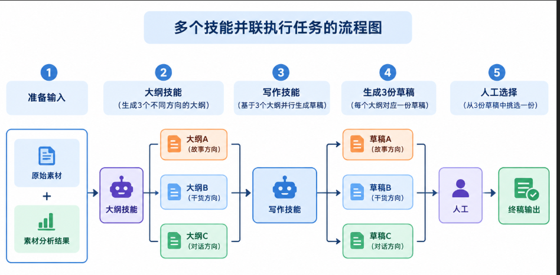

【画图提示词】

```c++
请按照如下描述画出多个技能采用并联方式执行任务的流程图：

1. 把原始素材，素材分析结果作为输入，传给 大纲技能
2. 大纲技能输出3个不同方向的大纲，包括大纲A（故事方向），大纲B（干货方向），大纲C（对话方向）
3. 把上述3个大纲作为输入，传给写作技能 ；
4. 写作技能 根据3个大纲输出3份草稿，包括草稿A，草稿B，草稿C 
5. 然后由人工从3份草稿中挑选出一份，作为终稿输出
```


### 【5.2.3】循环（打回重做）

1. 循环：打回重做；
2. <font color=red>循环的好处：质量逐轮提升</font>；让技能各做各的事情，让人来做决策；

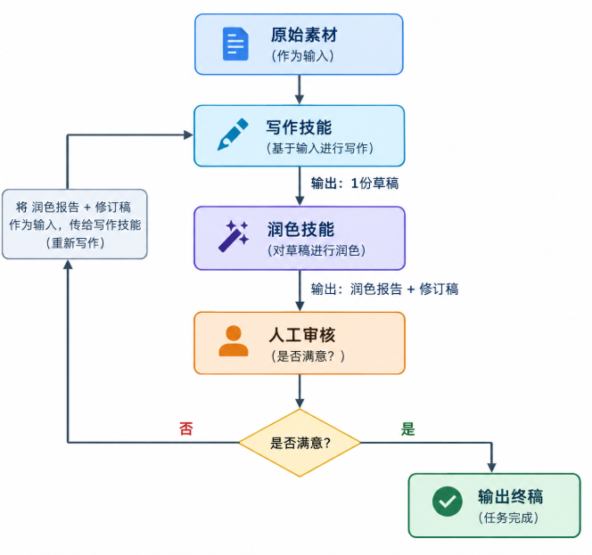

【提示词】

```c++
请按照如下描述画出多个技能采用循环方式执行任务的流程图：

1. 把原始素材作为输入，传给 写作技能
2. 写作技能 输出1份草稿
3. 然后由 润色技能 对草稿进行润色，输出 润色报告+修订稿
4. 由人工审核是否满意，若满意则输出终稿，若不满意则把润色报告+修订稿作为输入传给写作技能，让写作技能重新写作，输出草稿，重复步骤2
```

<br>

---

### 【5.2.5】导演口令模版

1. 要发出什么样的口令，才能让智能体按照制定的处理流程执行？

【串联口令】-已验证

```c++
先使用 discussion-analyzer 分析上述转录稿，输出到 discussion-analysis.md。 分析完成后暂停，把待办事项列给我确认。 我确认完成后，你再用  meeting-minutes 技能生成会议纪要。
```

【并联口令】

```c++
大纲技能生成了三份大纲（outline-a.md, outline-b.md, outline-c.md），用3个子智能体按照3份大纲各写一篇草稿，分别保存为 draft-a.md, draft-b.md, draft-c.md。 你只给我3份文件的文件路径和每份文件的一句话摘要。
```

【循环口令】

```c++
先用写作技能写一版初稿，保存为draft.md。 然后用润色技能润色 draft.md，输出润色报告 polish-report.md 和 终稿 final.md。 润色完成后暂停，把报告摘要给我看。
```

如果你看了报告觉得有问题需要重来，你可以继续说：

```c++
把 polish-report.md 交给写作技能，按报告中的问题重写 draft.md，然后再执行一次润色技能。 
```

2. <font color=red>口令的关键：是要说清楚中间产物和暂停点</font>。

#### 【5.2.5.1】技能之间怎么传数据

1. 口令里的关键词是文件名。技能之间有三种传数据的方式：
   1. 文件路径：告诉A把文件写到哪个目录，然后B去这个目录读取，大块数据一般用这种方式；
   2. 上下文共享：在同一个对话框里，后面直接用前面的输出，这种方式适合短对话；
   3. 格式约定：A输出 outline-x.md， B读取 outline-x.md，名字对上就能够自动衔接；

<br>

---

## 【5.3】子智能体上岗

### 【5.3.1】子智能体是什么？

1. 子智能体：是主智能体派出的专项助手； 
2. <font color=red>子智能体的3个关键特性</font>：
   1. 独立上下文：每个子智能体的上下文对话是从零开始的，它不知道主智能体之前和用户聊了什么，它只知道主智能体传给它的那段任务描述；
   2. 过程隔离：子智能体执行任务过程中的所有工具调用，中间结果，思考过程，全部留在自己的上下文里；主智能体可以只接受子智能体的最终结果的摘要或文件路径，从而节省空间；
   3. 同时开工：子智能体有各自独立的上下文，因此可以独立运行，互不打扰。这是并联组合方式得以实现的基础；

3. 示例：当用户下发并联口令后，主智能体的派单现场大概是这样的：

```c++
主智能体：
  “子智能体A，按照叙事风格写一篇作文，原始素材在 source.md，素材分析结果在 analysis.md，大纲在 outline-a.md”
  “子智能体B，按照叙事风格写一篇作文，原始素材在 source.md，素材分析结果在 analysis.md，大纲在 outline-b.md”
  “子智能体C，按照叙事风格写一篇作文，原始素材在 source.md，素材分析结果在 analysis.md，大纲在 outline-c.md”

3个子智能体各自独立工作......
  子智能体A： “写完了，文件在draft-outline-a.md”
  子智能体B： “写完了，文件在draft-outline-b.md”
  子智能体C： “写完了，文件在draft-outline-c.md”
  
主智能体收起3分成稿，等你挑选。
```

<br>

### 【5.3.2】怎么给子智能体派活

#### 【5.3.2.1】触发的两种方式（自动委派+显式调用）

1. 方式1：自动委派；你不需要点名，主智能体自己判断。每个子智能体都有一段描述，说明它擅长什么。当主智能体遇到匹配的任务时，会自动把任务委派过去；
   1. 例：claude code中，你会看到智能体自动使用agent工具，那就是它在委派子智能体； 
      1. <font color=red>claude code内置了3个主要的子智能体</font>： 
         1. Explore： 专门搜索和分析代码，只读不写；
         2. Plan： 在规划模式下做调研，只读不写；
         3. general-purpose：通用子智能体，能读能写能执行命令； 

2. 方式2：显示调用；用户直接在对话框中点名要求使用某个子智能体（同点名调用某个技能一样）；

例： 用 code-reviewer 子智能体检查我最近的提交

3. 子智能体被触发后的流程如下

```c++
接收任务 -> 在独立上下文中工作  -> 把最终结果返回给主智能体
```

<br>

#### 【5.3.2.2】主智能体向子智能体传递信息方式

1. 主智能体向子智能体传递信息方式：
   1. 方式1：在任务描述里直接写。这条路径适合传方向性的指令（如按叙事风格写），少量关键信息和约束条件，不适合传大段原始素材；
   2. 方式2：传文件路径，让子智能体自己去读。把大块数据存在文件里，任务描述里只写路径。这样一来，大块数据就能够完美绕过主智能体；
2. <font color=red>最佳实践：提示词传决策和方向，文件传数据和内容</font>；

3. 子智能体的所在位置： 子智能体通常就是一个独立的markdown文件（比如在 .claude/agents/目录下）

<br>

#### 【5.3.2.3】描述任务的4个要素（向子智能体交代任务）

1. 4个要素：
   1. 目标：交付物是什么（文件名或格式）；如输出draft-a.md,markdown格式；
   2. 约束：必须遵循的风格（可以包含禁止清单）；如加载 writing-style 技能，禁止使用“综上所述”；
   3. 输入：要读取哪些文件； 如读取 source.md, analysis.md, outline-a.md 
   4. 验收：交付前自检3条； 如(1)字数大于2000，(2)每个论点有素材支撑，(3)保存成功；

【任务描述示例1】

```c++
你是子智能体A。
  目标：按叙事风格写一篇文章，将其保存为 draft-a.md。
  约束：加载 writing-style 技能，开头用故事场景切入，不用“首先/其次/最后”；
  输入：读取 source.md(原始素材)，analysis.md（素材分析结果） 和 outline-a.md（大纲）。
  验收：(1)字数大于2000小于3000，(2)每个论点有素材支撑，(3)文件保存到当前目录。
```

【任务描述示例2】

```c++
你是文档审查子智能体。
  目标：审查 proposal.md, 输出修改建议报告  review-report.md。
  约束：只审查，不修改。关注3个维度：逻辑是否通顺，数据是否有来源，表述是否有歧义。
  输入： 读取 proposal.md 
  验收：(1)每条建议标注具体段落位置；(2)提出修改建议而非只指出问题;(3)报告保存成功。
```

注意： “只审查，不修改”这条约束，它对应子智能体的工具权限控制。约束里写清楚有助于智能体正确设置权限。

<br>

#### 【5.3.2.4】子智能体缺点

1. 子智能体缺点：
   1. <font color=red>信息在交接时会丢失</font>。主智能体给子智能体派任务，子智能体并不知道主智能体之前和你聊了什么；
   2. <font color=red>子智能体之间信息隔离</font>。子智能体A与子智能体B各有独立的上下文。A发现一个关键信息，B不会自动知道。
2. <font color=red>使用子智能体的原则</font>： 一个上下文能够完成的事情，不要使用子智能体；

<br>

### 【5.3.3】技能 vs 子智能体：用哪个

1. 任务处理流程的两种方案：
   1. 加个技能让智能体自己干；
   2. 智能体派个子智能体出去干；
2. 使用技能还是子智能体：
   1. <font color=red>使用技能：轻任务，要看过程</font>；任务不重，主智能体自己可以搞定；
   2. <font color=red>使用子智能体：重任务，只要结果</font>；任务极其耗费资源，中间过程很长，会产生大量中间结果或者需要多路并行；

3. 判断标准：如果只要结果，不看过程，就用子智能体；

<br>

#### 【5.3.3.1】自定义子智能体

很多平台支持你创建自定义子智能体。以claude为例，子智能体是一个markdown文件，放在 .claude/agents/目录下， 包含 YAML 前置信息（名称，描述，可用工具）和系统提示词。你可以用 /agents 命令交互式创建，也可以手写文件。

<br>

### 【补充-5.3.4】子智能体示例（创建子智能体）

【在claude创建子智能体】

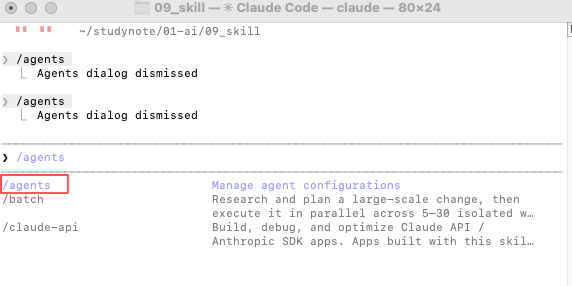

选择创建子智能体

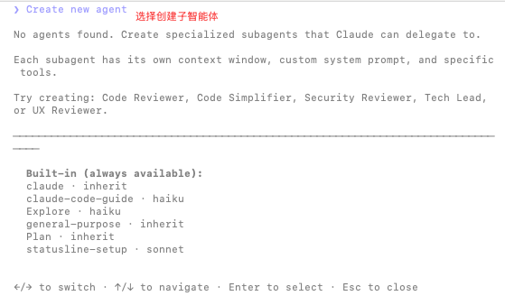

使用claude生成subagent：


描述子智能体的工作内容：

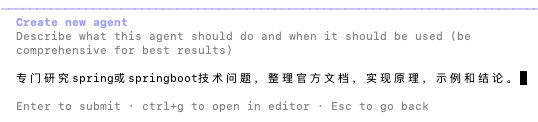

选择工具：

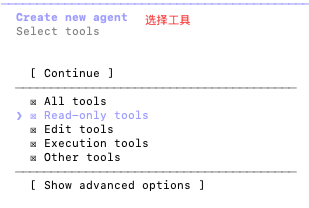

选择模型：

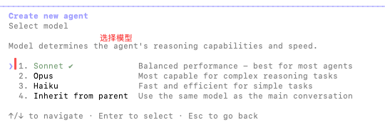

选择背景色：

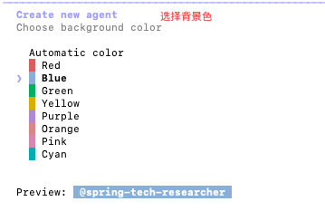

保存子智能体：

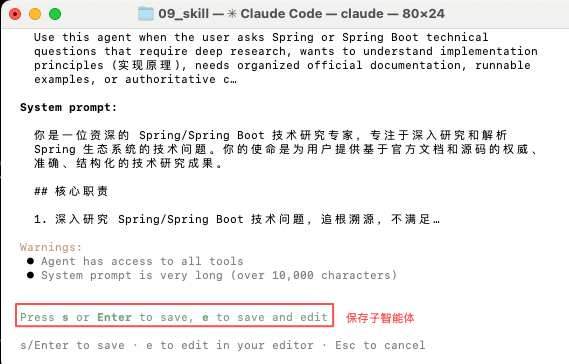

查看子智能体创建结果： 

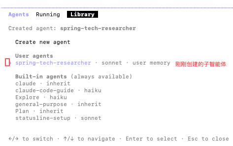

该子智能体的保存路径：~/.claude/agents

#### 使用子智能体分析spring技术点：

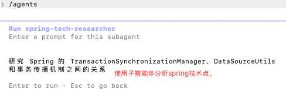

子智能体分析结果：

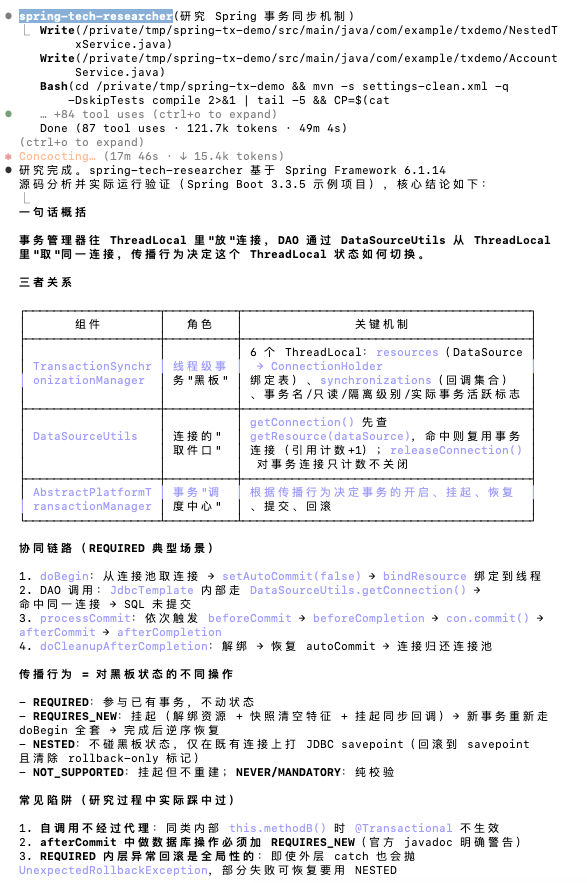

<br>

### 【补充-5.3.5】 Anthropic创建子智能体官方教程

[https://code.claude.com/docs/zh-CN/sub-agents#explore](https://code.claude.com/docs/zh-CN/sub-agents#explore)

<br>

---

## 【5.4】五个技能搭起一条写作工作流

###  【5.4.1】素材分析技能模板：深度分析

```markdown
---
name: content-analyzer
description: 深度分析素材内容。当用户提供论文，视频文稿，推文等内容并要求分析时使用
---

# 素材分析

## 输入
用户提供的素材文件

## 分析框架

### 核心内容
- 主题和核心论点
- 关键论据和数据
- 结论和建议

#### 背景语境
- 作者背景
- 行业背景
- 相关事件

### 批判审视
- 论证是否严密
- 有没有遗漏的视角
- 哪些说法需要验证

### 素材价值
- 最有传播价值的点
- 可以展开的角度
- 潜在争议点

## 输出
保存到素材文件所在目录， 文件名为 analysis.md 
已有同名文件时先备份再覆盖。
```

注意：上述是简化版， 详细版参见： [宝玉详细版技能](https://github.com/JimLiu/Illustrated-Agent-Skills/blob/main/%E9%99%84%E5%BD%95.md)

<br>

### 【5.4.2】大纲技能模板：生成多个方案

有个素材分析结果，接下来需要规划文章大纲。该技能可以生成三到五个不同方向的大纲方案。

为什么需要多个？ 因为同一份素材，可以从不同角度切入。你挑一个自己最有感觉的方向，比智能体直接替你做选择要好得多。

【技能内容】

```markdown
---
name: outliner
description: 根据source.md(原始素材)和analysis.md(素材分析结果)生成多个大纲方案。当用户要求“写提纲”或"拟大纲"时使用
---

# 大纲生成 

## 输入
- source.md(原始素材)
- analysis.md(素材分析结果)
- 用户补充的写作方向(可选)

## 输出要求
 
 生成三到五个差异化大纲方案，分别保存为独立文件。
 
 每个方案必须：
 - 有明确的切入角度(不能只是换标题)
 - 标注叙事策略（故事驱动 /  观点先行 / 对比论证 / 教程式）
 - 列出各部分标题和一两句内容概要
 - 标注预估字数
 
 至少有一个方案采用故事驱动策略。
 
 ## 输出文件
 
 保存到 analysis.md 所在的目录：
 - outline-a.md
 - outline-b.md
 - outline-c.md
 - outline-d.md(可选)
 - outline-e.md(可选)

已有同名文件时先备份再覆盖。

生成完毕后，列出方案摘要，等待用户选择。
```

【注意】上文提到的“等待用户选择”，这是一个人工检查点，工作流再这里暂停，由你来拍板。并不是所有步骤都要自动化。

上述是简化版技能，详细版参见[详细版大纲技能](https://github.com/JimLiu/Illustrated-Agent-Skills/blob/main/%E9%99%84%E5%BD%95.md#d2-%E5%A4%A7%E7%BA%B2%E6%8A%80%E8%83%BDoutliner)

<br>

### 【5.4.3】写作技能模板：并行写作生成初稿

1. 大纲定了，现在开始写。如果你选择了多个大纲方案（如A与C大纲），这里就是使用并联技能的场景，智能体派出2个子智能体同时生成两个版本的初稿，写完你从中挑一个。

2. 写作技能的结构和前两个技能的结构类似（输入，要求，输出），但有两个关键差异：
   1. 需要加载写作风格技能。 在技能里写一句“加载 writing-style技能作为风格约束”，相当于把另一套规则文件作为当前的全局约束条件， 智能体在写作时会同时遵循该风格规则。
   2. 需要内置验收规则。 完稿后让智能体从几个硬性指标（字数是否在范围内，是否引用了素材中的关键数据，文件是否保存成功）做一次基础自检；

注意：这里的自检只是交付前的出厂检验，即检查交付物的完整性，不是检查它的文笔。文笔的事情，交给下一环节的润色技能。

【技能内容】

```markdown
---
name: writer
description: 根据已确认的大纲(outline-x.md), 原始素材(source.md)和素材分析结果(analysis.md)进行写作，输出文章草稿。当用户要求写文章或写初稿时使用。
---

# 写作

## 风格约束
加载 writing-style 技能作为风格约束，写作全程遵循其中的所有规则。

## 输入
- source.md(原始素材)
- analysis.md(素材分析结果)
- 用户指定的 outline-x.md (已确认的大纲)

## 写作流程

### 第一步： 确认写作参数
从大纲中提取： 篇幅目标，叙事策略，正文结构，开头/结尾 策略。缺失的参数问用户。

### 第二步： 按大纲逐段写作
- 严格按照大纲结构展开，大纲没提的内容不写
- 引用素材中的关键数据和论据， 不确定的细节标注 [待确认]
- 不编造人民， 数据， 引用

### 第三步： 验收自检
完稿后检查以下硬性指标：
- 字数是否在大纲预估范围内
- 素材中的关键数据是否已引用
- 文件是否保存成功
不达标的指标自行修正后再交付。

## 输出 
保存到大纲文件所在的目录，文件名为 draft-outline-[方案字母].md 。
已有同名文件时先备份再覆盖。
```

<br>

### 【5.4.4】润色技能模板： 诊断问题，修改文章

润色技能：先诊断问题，再逐项修改； 

【技能内容】

```markdown
---
name: article-polish
description: 润色文章，提升可读性。当用户要求润色或改稿时使用。
---

# 文章润色

## 输入

- 待润色的文章

## 润色流程

### 第一步： 诊断

站在目标读者的角度通读全文，列出问题清单：
- 哪里读不通
- 哪里太啰嗦
- 哪里逻辑断裂
- 哪里有AI 味儿

### 第二步： 修改

按问题清单逐项修改。 没出修改标注原因。

### 第三步： 终检

加载 writing-style 技能，检查是否符合既定的写作风格。不符合的地方，逐一修改。

## 输出

保存到待润色文章所在目录。
- 润色报告: polish-report.md (修改了什么，为什么修改)
- 润色后的文章: final.md

已有同名文件时先备份再覆盖。
```

<br>

## 【补充】使用技能模版创建技能并使用技能

#### 【提示词】

```c++
根据这个 ~/studynote/01-ai/09_skill/my_skill_template/01_analyzer_template.md 技能模版，帮我创建用户级别的素材分析技能   
根据这个 ~/studynote/01-ai/09_skill/my_skill_template/02_outliner_template.md 技能模版，帮我创建用户级别的大纲技能   
根据这个 ~/studynote/01-ai/09_skill/my_skill_template/03_writer_template.md 技能模版，帮我创建用户级别的写作技能
根据这个 ~/studynote/01-ai/09_skill/my_skill_template/04_polish_template.md 技能模版，帮我创建用户级别的润色技能
```

#### 【使用素材分析技能与写作技能】

准备好原始素材，发给智能体，说：

```c++
先用素材分析技能分析这份素材(~/studynote/01-ai/09_skill/result-discussion-analysis.md)，保存为 analysis.md，然后用写作技能根据分析结果写一篇文章，加载我的写作风格技能，保存草稿文件为draft.md。analysis.md 与 draft.md 文件保存目录为原始素材所在目录。
```

#### 【使用素材分析技能+大纲技能+写作技能】

```c++
先用素材分析技能分析这份素材(~/studynote/01-ai/09_skill/result-discussion-analysis.md)，保存为 analysis.md, 再根据原始素材和analysis.md生成三个大纲方案给我选择，最后按照我选择的大纲使用写作技能写一篇文章，加载我的写作风格技能，保存草稿文件为draft.md。analysis.md 与 draft.md 文件保存目录为原始素材所在目录。
```

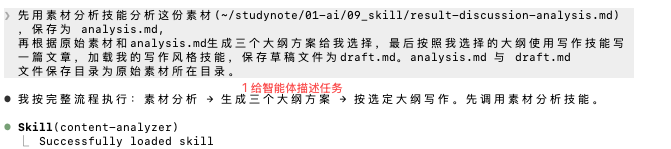

接着，智能体让用户选择大纲：

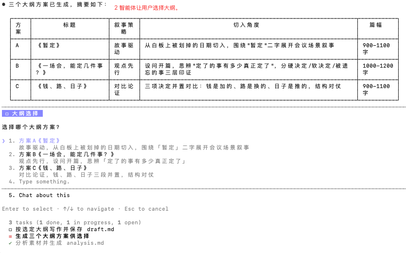

<br>

#### 【使用4个技能写文章：素材分析技能+大纲技能+写作技能+润色技能】

```c++
先用素材分析技能分析这份素材(~/studynote/01-ai/09_skill/result-discussion-analysis.md)，保存为 analysis.md, 再根据原始素材和analysis.md生成三个大纲方案给我选择，然后按照我选择的大纲使用写作技能写一篇文章，加载我的写作风格技能，保存草稿文件为draft.md，最后使用润色技能对草稿进行润色处理。其中analysis.md 与 draft.md 文件保存目录为原始素材所在目录。
```

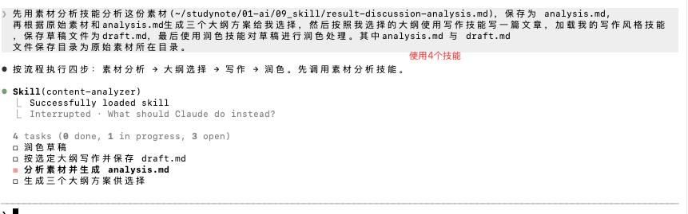

<br>

---

# 【6】工程化：从需求到上线的技能开发全流程

软件开发经验：需求分析 -> 设计 -> 实现 -> 测试  -> 上线与发布 ; 

把上述软件开发经验应用到技能开发上， 发现完全适用，如下。

| 软件开发   | 技能开发                       |
| ---------- | ------------------------------ |
| 需求分析   | 想清楚技能解决什么问题，给谁用 |
| 设计       | 定流程，定规则，防踩坑         |
| 实现       | 写SKILL.md，让智能体帮你创建   |
| 测试       | 验证触发，输出质量，对比效果   |
| 上线与发布 | 安全检查，团队分享，发布到社区 |

## 【6.1】需求分析：动手前先想清楚

### 【6.1.1】好技能从真实痛点长出来

先用提示词解决问题，反复踩坑后再封装成技能； 

### 【6.1.2】5分钟定义需求（回答6个问题）

1. 问题清单：
   1. 问题：解决什么
   2. 场景：谁在什么时候用
   3. 输入：需要什么 
   4. 输出： 产出什么
   5. 规则：有什么约束
   6. 禁止清单： 绝对不能做什么 

【例】为文章生成小红书信息图

```c++
1. 问题：把文章自动拆分为小红书风格的系列信息图
2. 场景： 用户说“帮我做一组小红书图片”
3. 输入： 一篇文章（markdown文件或 直接粘贴）
4. 输出： 每张图的大纲文件 + 生成的图片文件
5. 规则： 竖版 3:4 ， 卡通手绘风， 每张只传达一个核心信息
6. 禁止清单： 不能用写实风格， 不能跳过大纲确认直接生成；
```

这6个问题的答案，基本就是小红书信息图技能的 SKILL.md  的骨架了；

<br>

## 【6.2】设计： 四招让技能更加靠谱

【4个技能设计技巧】

1. 踩坑点： 把事先想不到，用多了才暴露出来的教训，作为专门的补充写进文件； 
2. 可容错： 假定一定会遇到意外， 给智能体预留好<font color=red>开头检查</font>，人工确认和中间结果存盘的应急方案； 
3. 可扩展：让技能支持组合或外挂配置， 以后增加新需求时，不需要去修改原来的主文件； 
4. 跨对话记忆： 单独维护一个记录文件，让智能体下次接着上次的进度继续跑；

<br>

### 【6.2.1】记录踩坑点： 记下反复犯的错

1. Anthropic内部几百个技能的实践表明： 一个技能里信息密度最高的部分，往往不是流程说明，而是踩坑点（记录智能体在使用这个技能时反复犯的错）；

2. 建议你在每个技能的 SKILL.md 里预留一个 踩坑点 的部分。 

【例】skill技能文件中的踩坑点

```markdown
## 踩坑点

- 生成图片时容易忽略用户指定的宽高比，每次生成前重新读取尺寸参数
- 中文标签和英文标点混用，所有标点统一用中文全角 
- 总以为把模版放到 references/ 目录下，智能体自己会去查找， 结果发现它根本不会主动跨文件读取。每次生成前必须加一句强提醒：智能体不会自动发现外部文件。如果调用了 references/ 目录下的文件，必须在这里明确给出指令： 先读取 report-template.html, 再生成 HTML 报告。
```

3. 踩坑点与禁止清单的区别： 
   1. 禁止清单： 事前设计时就能想到的硬性底线； 
   2. 踩坑点： 事后使用中才暴露的意外盲区； 

<br>

### 【6.2.2】可容错： 假定一定会出现意外 

1. 设计要做到可容错，考虑如下三个方面：
   1. 开头检查输入
   2. 人工确认
   3. 存文件

#### 【6.2.2.1】 开头检查输入

如接口校验输入报文参数是否满足条件类似， skill也可以对用户输入进行有效性检查。

【例】输入检查

```markdown
## 第一步： 检查输入
- 如果没有提供内容， 询问用户
- 如果内容少于 100 字， 提醒内容较短
- 如果文件格式不在支持列表中（如上传了 PDF，但技能只支持 markdown）， 提醒用户转换格式
- 如果内容超过 10000 字， 建议先指定重点
```

#### 【6.2.2.2】关键步骤人工确认

让智能体在容易走偏的地方停一下， 等你确认完成后再继续。 

#### 【6.2.2.3】中间结果随手存文件

别让所有生成结果都存在对话里， 要把中间结果都保存成文件。 

<br>

### 【6.2.3】可扩展： 随时添加新功能

1. <font color=red>软件开发有一条经典原则——开闭原则： 对扩展开放，对修改关闭</font>。
2. 把这个思路套用到技能上： 让技能在不修改 SKILL.md 的基础上， 也能适应新需求。具体是：把稳定流程 与 变化细节 分开； 

#### 【例】团队共享的技能的扩展设计

所有技能都支持通过扩展文件（EXTEND.md） 进行自定义， 无需修改原技能：

```markdown
扩展文件查找顺序（优先级从高到低）
1. 项目/<技能名>/EXTEND.md  <- 项目级（团队/项目专用配置）
2. 用户家目录/<技能名>/EXTEND.md  <- 用户级（个人偏好）
```

比如你想给封面图生成技能加一套企业品牌配色， 不用修改原技能的 SKILL.md, 只需要在项目目录下创建一个扩展文件： 

```markdown
## 自定义配色方案

### corporate-tech
* 主色： #1a73e8, #4A90D9
* 背景色： #F5F7FA
* 强调色： #00B4D8, #48CAE4
* 风格提示： 简洁线条， 微渐变 
* 适合： SaaS， 企业， 技术类 
```

【<font color=red>注意</font>】 扩展性是技能跑通后需要考虑的； 对于一个还没有经过真实场景验证的技能， 把核心流程跑通，把异常情况防住，永远比预留扩展点重要。

<br>

### 【6.2.4】跨对话记忆：记住上次做了什么

1. 好的设计不仅要考虑空间上的扩展，还需要考虑时间上的连续；

【例】

在项目目录下按照微信群建议文件夹，把每次生成的聊天记录保存为文件（比如 2026-03-12.md），同时维护一个 history.json 记录上次汇总最后一条消息的时间。下次运行时， 技能先读这个时间，只拉取这个时间之后的新消息。用户说“接着上次汇总”， 技能就知道从哪里继续了。

```markdown
wechat/
|- AI 技术交流群
|  |- history.json
|  |- 2026-03-12.md
|  |- 2026-03-13.md
|- 产品经理群/

```

<br>

### 【6.2.5】设计检查清单

写完SKILL.md， 对照下面这张清单评审一下。

1. 单一职责： 这个技能只做一件事情吗 
2. 按需加载： SKILL.md 的name， description， 正文是否符合最佳实践？ 详细内容是否拆到了 references/ 目录 ？
3. 可预测： 有没有明确的输出格式和示例？
4. 可容错： 输入为空或异常时会怎么样？ 关键步骤有没有人工确认？
5. 可扩展：稳定的流程和变化的细节是否分开；
6. 跨对话记忆： 有没有单独维护一个记录文件；
7. 踩坑点： 有没有预留踩坑点部分？
8. 禁止清单： 有没有写清“不要做什么”；

<font color=red>设计检查清单分类</font>：

1. 基础设计：单一职责， 按需加载，可预测， 可容错； 
2. 演进能力：可扩展， 跨对话记忆， 踩坑点， 禁止清单；

<br>

---

## 【6.3】实现： 人机写作创建技能

技能开发过程中，需要编写 SKILL.md 和 配置关联文件； 技能开发工作，完全可以让智能体来写；

- <font color=red>让智能体创建技能有一个天然优势</font>：技能本身就是给智能体用的， 它比我们更清楚什么样的指令更适合自己；让使用者自己来写使用说明， 自然就比外人写得更到位； 

### 【6.3.1】分工： 你决策，智能体执行

创建技能的思路： 你定需求和标准，智能体负责写和改； <font color=red>你的角色是决策者和验收者， 智能体的角色是执行者</font>.。 

<font color=red>人工与智能体的人机协作职责分工如下</font>：

| 阶段     | 人工职责                         | 智能体职责                     |
| -------- | -------------------------------- | ------------------------------ |
| 定义需求 | 定义做什么，为什么做             | 理解意图                       |
| 沉淀经验 | 提供领域经验和踩坑教训           | 内化经验                       |
| 创建内容 | 通过提示词下达构建指令（提需求） | 编写  SKILL.md 和 配置关联文件 |
| 验证质量 | 检查输出是否符合预期             | 无                             |
| 调试修复 | 发现并描述问题                   | 定位问题并完成修复             |

<br>

### 【6.3.2】逐步构建： 不求一步到位

技能从简单到复杂， 最直观的体现是文件夹结构的演进，如下。

| 复杂度 | 结构                              | 适用场景                        |
| ------ | --------------------------------- | ------------------------------- |
| 轻量   | 仅 SKILL.md                       | 纯规则类技能，且不依赖关联文件  |
| 中等   | SKILL.md + references/            | 依赖规范，文档等参考资料        |
| 重量   | SKILL.md + references/ + scripts/ | 数据处理， 固定计算等确定性任务 |

#### 【6.3.2.1】技能从起步到成熟会经历4个阶段

1. 四个阶段：
   1. 跑通 MVP。 核心目标只有一个——技能能用； 
   2. 功能补齐。核心动作是做加法。也就是高频修改 SKILL.md, 打补丁；
   3. 架构重构。核心动作是：做拆分。随着功能补丁越打越多， SKILL.md 必然变得臃肿。 此时必须整理结构，拆分文件——把复杂的背景知识抽离到参考文档目录，或者将过度膨胀的技能拆分为两个独立的技能。 
   4. 阶段4： 持续优化（长期进行）。 核心动作：打磨。
      1. 每次遇到不满意的输出，就是一次优化的机会，目标是让技能从能跑蜕变为靠谱；

---

## 【6.4】测试： 验证技能好不好用

如果你的技能是给自己用，跑几遍第4章的三步验证就够了（触发测试，功能测试，对比测试）； 

但如果你的技能是要交付给团队使用，或者发布到技能市场给更多人用， 就需要一套靠谱的评测方法；

Anthropic 和 OpenAI 都在官方文档推荐： 使用评测来迭代改进技能。 评测简称Eval(Evaluation)， 本质其实就是一个“评测驱动的改进循环（<font color=red>评测循环</font>）”

<font color=red>评测驱动的改进循环</font>：

1. 准备考题： 构建测试用例
2. 定评分标准： 写客观检查项 
3. 对比打分： 有无技能跑测
4. 对症下药： 根据丢分项修改技能 

为什么需要先建立这个循环思维？ 

- <font color=red>因为 SKILL.md 里的提示词牵一发而动全身——你为场景A新增一条新规则，有可能把场景B搞崩了</font>。 
- 这个循环的最大意义： 不仅是证明当前版本有多好， 更是为了防退化。 

### 【6.4.1】准备考题： 构建测试用例

1个测试用例包含三部分： 一条指令（模拟用户怎么说）， 输入（如果需要）， 期望结果（大致描述好的输出长什么样子）； 

```markdown
测试用例1
  - 指令： 帮忙我整理一下昨天产品评审会的纪要
  - 输入： 一份 30分钟 的会议转录稿 
  - 期望结果： 按模版格式输出纪要， 包含决议事项和待办清单

测试用例2
  - 指令： 这个讨论记录太长了，帮我提炼重点
  - 输入： 一份 90分钟 的头脑风暴转录稿
  - 期望结果： 提炼核心讨论点和将诶盖伦，过滤闲聊
```

刚起步的时候，测试用例不用多，准备两三个就足够了，但有3个要求（<font color=red> 测试用例的3个要求 </font>）：

1. 指令要像真人说话
2. 覆盖多种情况：一个用正式说法，一个用口语； 一个输入端，一个输入长；最好还有个边界情况； 
3. 别忘了反例；除了“应该触发技能”的用例， 也准备一个“不应该触发技能”的用例； 

<font color=red> 建议把测试用例单独建档， 形成专属题库 </font>； 

- 日常使用一旦出现问题， 就把当时的指令与输入固化为新测试用例补充进题库； 同时把对应的整改规则（踩坑点）写进 SKILL.md 。 

<font color=red>测试用例与踩坑点区别：</font>

1. 提炼踩坑点： 将具体的约束（如 遇到行业术语，必须用行业惯用语）写进 SKILL.md， 用来教智能体做事；
2. 固化测试用例（留案发现场）： 把引发问题的原始对话和文件存入独立的测试用例文件。 千万别把考题也写进 SKILL.md， 那会干扰智能体的正常运行； 
3. <font color=red>总结： 把踩坑点写进 skill.md， 失败案例存入测试题库</font>； 

<br>

### 【6.4.2】定评分标准： 写客观检查项 

评分标准，即客观检查项，简称检查项。 

好的检查项是具体的，能直接判断对错：

```markdown
纪要包含待办事项清单
每个待办事项标注了负责人
纪要篇幅不超过原文的 30% 
技能被正确触发
```

<br>

### 【6.4.3】对比打分： 有/无技能跑测

用同一个测试用例跑两遍——一遍用技能，一遍不用技能（也就是直接把提示词送入大模型做分析）； 

对技能做评测的价值：不在于看它的绝对输出有多好， 而在于看它相比于裸跑，把下限提升了多少。

跑完开发的技能后，严格执行如下3个动作：

1. 整理评测记分表； 
2. 做主观验收， 留下工程化反馈； 
   1. 客观检查项能够检查的问题是有限的，所以需要人工验收；
3. 算一算“质量与耗时”的经济账；

【补充】评测计分表示例（会议纪要技能）

| 检查项                   | 有技能 | 无技能 |
| ------------------------ | ------ | ------ |
| 技能被正确触发           | ✅      |        |
| 纪要包含待办事项清单     | ✅      | X      |
| 每个待办事项标注了负责人 | ✅      | X      |
| 纪要篇幅不超过原文的 30% | X      | X      |
| 格式符合模版             | ✅      | X      |
| 通过率                   | 4/5    | 0/5    |


<br>

### 【6.4.4】对症下药： 根据丢分项修改技能

1. 对比打分后， 你手上其实已经攒了两份改进依据：
   1. 没通过的检查项（指出具体缺了什么）
   2. 主观问题； 
2. 两份依据合并在一起， 就代表了技能的修改方向。 
   1. <font color=red>修改技能前，必须牢记一条原则： 治病要治根，不能头疼医头脚疼医脚，要找到通用的解法，别只为某一个测试用例打补丁</font>；

3. <font color=red>修改技能的循环迭代过程中，有3个实操心法</font>：
   1. 检查项本身也要迭代修改； 
   2. 老技能升级， 要做对比测试； 
   3. 把反馈交给智能体， 让它自己改 ； 

4. 做到什么程度，取决于场景。
   1. 对于自用技能：大部分情况下， 脑子过一遍检查项，再把技能跑两遍就够了，不用写文件记录；
   2. 但对于团队级技能：需要把测试用例和检查项存下来，方便每次改完技能能够做快速回归验证。
      1. 编码智能体 如 Claude code 还能帮你自动跑测试， 生成对比报告， 进一步减少手动工作； 

---

## 【6.5】上线与发布： 高效，安全地把技能分享给全世界

技能使用的三种场景：

1. 给自己用： 过一遍安全清单就行了 
2. 给团队用： 还要考虑分发和质量； 
3. 给社区用：在做好前面工作的基础上，还要考虑配套文档，环境兼容性和长期可维护性；

### 【6.5.1】个人自用

#### 安全清单：

权限控制：

```markdown
- 读取哪些目录，是否超出业务必需的范围
- 写入哪些目录，是否限定在 output/ 等安全路径
- 是否需要联网， 仅访问可信域名 
- 按需启用代码执行， 明确执行边界和用途 
```

不可逆操作保护

```markdown
- 删除操作前确保二次确认
- 发布操作前增加预览校验 
- 覆盖文件前检查同名文件，遇到同名文件先备份 
```

#### 按照等级对技能分为三类：低风险，中风险，高风险；

它们需要不同级别的安全措施，如下：

| 风险等级 | 特征                  | 安全措施                  |
| -------- | --------------------- | ------------------------- |
| 低风险   | 只读取，只生成文件    | 基本权限控制              |
| 中风险   | 修改文件，调用外部API | 操作前确认 + 权限控制     |
| 高风险   | 发布到外部平台        | 多步确认 + 预览+ 环境预检 |

#### 按需钩子：更精细的防护

在claude code中， 可以通过钩子机制构建一类 “按需启用”的安全策略。

你可以将这些策略封装到技能，通过类似 /careful 这样的技能触发， 在需要时临时进入更严格的执行模式；

【例】PreToolUse钩子 

可以借助 PreToolUse 钩子， 在执行Bash 或 文件操作前， 对命令进行检查： 一旦检测到 rm -rf, drop table 等高风险操作， 就直接拦截或要求确认， 也可以限制修改范围， 例如禁止对指定目录之外的文件进行写入。 

<br>

### 【6.5.2】团队分享

如果你在团队中推广技能， 需要考虑两件事：

1. 如何分发： 把技能提交到团队项目的代码仓库，或者发布到内部技能市场；
2. 如何保证质量： 技能创建门槛低， 容易出现质量参差不齐或功能重复的问题； Anthropic内部的做法是先在沙盒文件夹里适用或在 Slack中推荐给同事，获得足够关注后再正式发布到技能市场；

<br>

### 【6.5.3】社区发布 

#### 发布技能到社区的准备工作

#### 【6.5.3.1】发布前准备清单：

```markdown
- 重新审视 description： 面向陌生人， 一句话说清干什么，覆盖场景触发说法
- 说明文档（README 或 技能简介）： 功能说明 + 使用示例 + 依赖说明 + 兼容性
- 清理个人信息： 搜索 key, token, password, 绝对路径， 确认无残留； 
- 加版本号： frontmatter 里 加version字段， 初始版本可以标注为  v1.0.0 
```

#### 【6.5.3.2】各平台发布要点

不管是发布到 Coze，ClawHub 还是直接在 Github 开源， 不同平台的提交流程虽然不一样，但本质上你都需要向平台提供三项内容： 

1. 唯一的标识符
2. 符合语义化规范的版本号-version
3. 以及一份优秀的说明文档； 

#### 【6.5.3.3】发布之后

发布之后， 用技能的人不在只是你自己了；

留意用户反馈（GitHub Issues, 商店评论， ClawHub 评分），并持续迭代；

<br>

---

## 【6.6】 小结 

### 【6.6.1】技能开发流程小结

1. 技能开发流程小结-五阶段流程
   1. 需求分析： 填写需求卡， 6个问题定骨架； 
   2. 设计四招： 踩坑点， 可容错， 可扩展， 跨对话记忆； 
   3. 人机协作创建技能： 你决策，智能体执行 
   4. 评测循环： 
   5. 上线与发布： 个人 -> 团队 -> 社区  

2. 设计原则：
   1. 先跑通， 再演进 
   2. 治病治根， 别打补丁 
3. <font color=red>评测循环（下面4步是一个循环）：</font>
   1. 准备考题； 
   2. 定标准； 
   3. 对比打分；
   4. 对症下药； 

<br>

---


